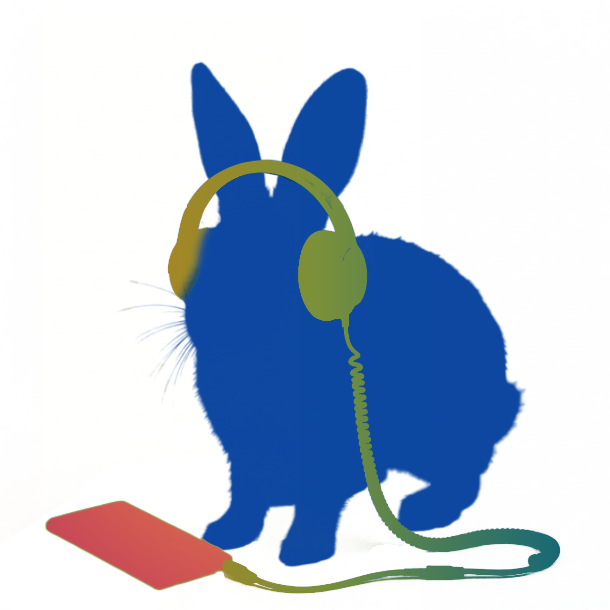

<p align="center">
  
</p>

<h1 align="center">Xargoosh Music Player</h1>

<p align="center">
  <strong>A private, local-first Android music player crafted for audiophiles and personal music collections.</strong>
</p>

<p align="center">
  <a href="https://github.com/arshiatxd/XargooshMusicPlayer/releases/latest"></a>
  <a href="CHANGELOG.md"></a>
  <a href="#-license--terms"></a>
  <a href="#-languages--technologies"></a>
</p>

---

## 🔒 Closed Source Notice

**Xargoosh Music Player is proprietary, closed-source software.**  
This repository serves exclusively for **binary distribution**, **release downloads**, **issue tracking**, and **official changelogs**. The source code is private and not published to public repositories.

---

## 💻 Languages & Technologies

The application is built natively for Android using modern technologies:

| Component | Language / Technology |
| :--- | :--- |
| **Core Programming Language** | **Kotlin** (100% native codebase) |
| **UI Framework** | **Jetpack Compose** (Declarative Kotlin UI & Material 3) |
| **Resources & Vector Graphics** | **XML** (Android Drawables, Themes & Strings) |
| **Build Configuration** | **Kotlin DSL** (`build.gradle.kts`) |
| **Audio Engine** | **AndroidX Media3 / ExoPlayer** & Android AudioFx |
| **Database** | **Room Persistence Library** (SQLite) |
| **Supported Natural Languages** | **22 Languages** (English, Persian/فارسی, Chinese, Spanish, French, German, Russian, etc.) |

---

## 📥 Download & Verification

Download the latest official APK from the [Releases](https://github.com/arshiatxd/XargooshMusicPlayer/releases) tab.

### Official Binaries (v1.1.1)

| Asset | Size | SHA-256 Checksum | Signature |
| :--- | :--- | :--- | :--- |
| **`app-release.apk`** | ~66.7 MB | `8e51c201c567feafdf65930351b694e89f8ee0d31a0b4c93b9f5512068e5cc51` | APK Signature Scheme v2 (Verified) |

> [!TIP]
> You can verify the integrity of the downloaded APK using PowerShell:
> ```powershell
> (Get-FileHash -Path .\app-release.apk -Algorithm SHA256).Hash
> ```

---

## 📱 Requirements

| Specification | Requirement |
| ------------- | ----------- |
| **OS Version** | Android 10.0 (API 29) or newer |
| **Architecture** | ARM64-v8a, armeabi-v7a, x86_64 |
| **Storage** | ~70 MB free space + your audio files |
| **Permissions** | Audio / Media Storage access; Microphone (only for visualizer & on-demand recognition) |

---

## 📄 License & Terms

Copyright &copy; 2026 Arshia ([@arshiatxd](https://github.com/arshiatxd)). All Rights Reserved.

- Binary releases are provided for personal, non-commercial use on compatible devices.
- Reverse engineering, decompilation, unauthorized redistribution, extraction of proprietary assets, and commercial resale are strictly prohibited.
- For complete terms and conditions, please consult the [LICENSE](LICENSE) file.
